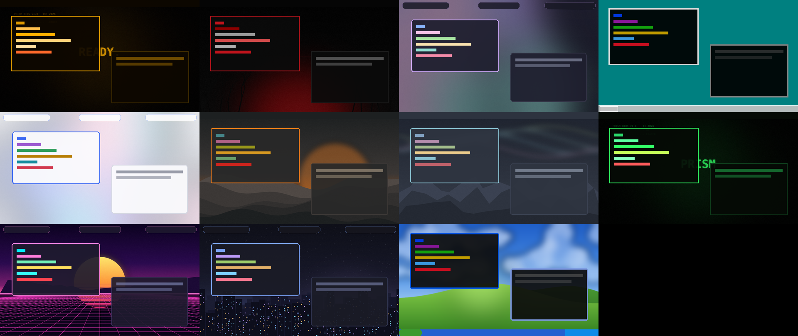

# ◆ Prism — a Hyprland rice for Arch Linux

Eleven themes — retro and modern — that restyle **everything at once**: window borders, gaps
and animations, the Waybar bar (with five different bar layouts), kitty, rofi, notifications,
the lock screen, fastfetch and GTK apps. Plus a real **settings app** so you never have to edit
a config file for daily stuff.



## Install

```bash
git clone https://github.com/rxvy-dev/rxvy-hyprland-dotfiles prism && cd prism
./install.sh
```

The installer asks a few questions (packages, starting theme, NVIDIA driver, services).
`./install.sh -y` takes the defaults; `./install.sh --theme synthwave` picks a theme;
`./install.sh --no-packages` only copies configs.

Your existing `hypr`, `waybar`, `kitty`, `rofi`, `mako` and `fastfetch` configs are **moved to
`~/.config/prism-backup-<date>`** first — nothing is deleted. `./uninstall.sh` removes Prism and
offers to put them back.

Then log out and choose **Hyprland** at the login screen, or run `start-hyprland` from a TTY.

> Requires **Hyprland 0.55 or newer** (the new Lua config). The installer warns you if yours is older.

## Themes

| Retro | | Modern | |
|---|---|---|---|
| **XP Bliss** | blue taskbar, green start button, sunny hills | **Tokyo Night** | cool blues, floating bar (default) |
| **Classic 98** | grey bevels, navy, teal desktop | **Catppuccin Mocha** | soft pastel mauve |
| **Phosphor CRT** | green-screen glow, scanlines | **Nord** | arctic, calm, aurora |
| **Amber Terminal** | warm amber monochrome | **Gruvbox** | warm retro-groove tones |
| **Synthwave '84** | neon sunset + grid | **Blackened** | pitch black + blood red, sharp |
| | | **Daylight** | bright light theme |

Switch with **Super+T** (picker with previews), **Super+Shift+T** (next), the settings app, or
`prism theme <id>`.

## Settings app — Super+I

Themes · Wallpaper (add your own) · Appearance (bar style & position, rounding, gaps, borders,
blur, shadows, animation style, opacity, fonts) · Input (keyboard layouts, mouse speed, natural
scroll) · Displays (resolution, refresh rate, scale, position) · Power & Lock (idle lock, screen
off, suspend, night light) · Apps & Startup (default apps, autostart, fastfetch logo).

Every change applies live.

## Keys

| Key | Action | Key | Action |
|---|---|---|---|
| Super+Return | kitty | Super+Q | close window |
| Super+Space | app launcher | Super+F / M | fullscreen / maximize |
| Super+E | files | Super+G | float / tile |
| Super+B | browser | Super+1…0 | workspaces |
| Super+I | settings | Super+Shift+1…0 | move window to workspace |
| Super+T | theme picker | Super+arrows | focus |
| Super+W | wallpaper picker | Super+Shift+arrows | move window |
| Super+V | clipboard history | Super+Ctrl+arrows | resize |
| Super+N | night light | Super+S | scratchpad |
| Super+L | lock | Print | screenshot region |
| Super+Esc | power menu | Super+F1 | **all keybinds** |

## Command line

```bash
prism themes                 # list
prism theme nord             # switch
prism wallpaper ~/pic.jpg    # or: random / theme
prism set gaps_out 20        # any setting (prism get shows them all)
prism reset gaps_out         # back to the theme's value
prism nightlight toggle
```

## Customising

* `~/.config/hypr/custom.lua` — your own Hyprland binds/rules/monitors, loaded last, never overwritten.
* `~/.config/waybar/custom.css`, `~/.config/kitty/custom.conf` — same idea.
* **Make a theme:** copy `~/.local/share/prism/themes/nord` to a new folder, edit `theme.conf`, drop in
  `wallpaper.png`/`.jpg`. It shows up immediately in `prism themes` and the settings app.

Files ending up in `~/.config` with `GENERATED BY PRISM` at the top are rewritten on every theme
change — tweak the custom files instead.

## Notes

* Hyprland doesn't draw title bars, so the retro themes get their vibe from the bar, borders,
  colors, fonts, launcher and terminal rather than XP/98-style window chrome.
* NVIDIA is detected automatically and the right Wayland env vars are set.
* Emoji picker (Super+.) needs `rofi-emoji` from the AUR.
* The wallpapers are original artwork generated for Prism.

## Old dotfiles

The previous setup (dunst, quickshell, wlogout) lives at the [`pre-prism`](../../tree/pre-prism) tag.
